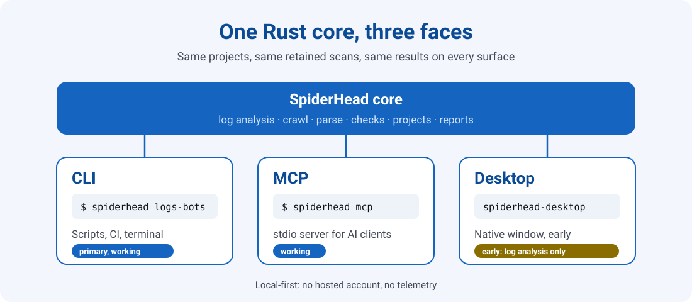
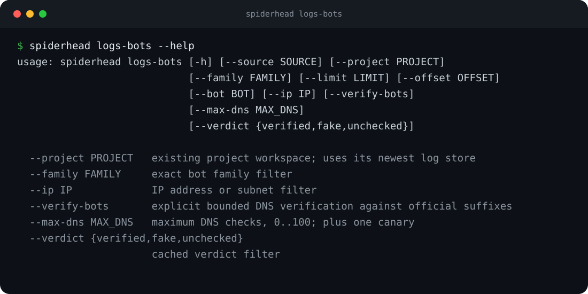

<p align="center"></p>

<p align="center">


<a href="LICENSE"></a>


</p>

<p align="center">
<a href="https://github.com/PavloSEO/spiderhead"><b>GitHub</b></a> &nbsp;·&nbsp;
<a href="https://spiderhead.dev"><b>Website</b></a> &nbsp;·&nbsp;
<a href="docs/COMPONENTS.md"><b>Docs</b></a> &nbsp;·&nbsp;
<a href="ROADMAP.md"><b>Roadmap</b></a> &nbsp;·&nbsp;
<a href="CHANGELOG.md"><b>Changelog</b></a> &nbsp;·&nbsp;
<a href="CONTRIBUTING.md"><b>Contributing</b></a>
</p>

**SpiderHead is a working environment for an SEO specialist and their AI agent.** Analyse server
logs, crawl a site, parse pages and keep the results in a project on your own machine — from the
terminal, through Claude over MCP, or in a desktop window.

- **One core, three faces.** The `spiderhead` CLI, the MCP server and the desktop app share the same
  Rust core and the same projects.
- **Projects, not one-off runs.** Results live next to your site in a `seo/` folder, so the next
  session starts where the last one ended.
- **Local-first.** No hosted account, no telemetry; paid providers run only with your key and your
  confirmation.

> **Status: 0.9, first public snapshot.** The command line is the primary, working surface. The MCP
> server works through the same binary. The desktop app is early and its visuals are weak.
> See [ROADMAP.md](ROADMAP.md).

<p align="center"></p>

## What works today

| Surface | State |
|---|---|
| `spiderhead` CLI | Primary and working. 250+ commands: **log analysis** (`logs-import`, `logs-summary`, `logs-bots` with IP-range, reverse-DNS and ASN verification of search and AI bots), **crawling** (`crawl-site`), **page parsing** (`parse`), **projects** (`seo/` autodiscovery, `spiderhead init`), data sources, semantics, audits and reports |
| MCP server | `spiderhead mcp` serves the same tools over stdio (`spiderhead-mcp` is kept as an alias) |
| Desktop app | Early. Log analysis opens from the launcher; the crawler UI and the agent mode are marked "coming soon". Expect rough visuals |

Not finished yet (see the roadmap): some comparison commands, content and image tools, the
Cloudflare Logpush / Instant Logs importers, and a Windows build of every component.

<p align="center"></p>

## Install

There are no signed releases or prebuilt binaries yet. Build from source with the Rust toolchain
pinned in `rust-toolchain.toml`:

```sh
git clone https://github.com/PavloSEO/spiderhead.git
cd spiderhead
cargo build --release
# binaries: target/release/spiderhead  spiderhead-mcp  spiderhead-desktop  spiderhead-desktop-ctl
```

`cargo xtask dist` and `cargo xtask package macos|linux|windows` produce profile archives and
installers (see [docs/COMPONENTS.md](docs/COMPONENTS.md)). The desktop app has menu actions
*Install command in terminal* (links the bundled `spiderhead` into a user-writable `PATH`
directory) and *Connect to Claude* (copies the MCP config snippet; it never edits client
configuration files).

## Quick start

```sh
spiderhead --help

# analyse server logs
spiderhead logs-import --help
spiderhead logs-summary --help
spiderhead logs-bots --help

# crawl a site (read-only, polite by default)
spiderhead crawl-site --help
```

Use it from an AI client: add the server to the client's MCP settings.

```json
{
  "mcpServers": {
    "spiderhead": { "command": "spiderhead", "args": ["mcp"] }
  }
}
```

With Claude Code: `claude mcp add spiderhead -- spiderhead mcp`.

## Project model

A project is a `seo/` folder inside your site's working tree:

```
my-site/
  seo/
    project.json     manifest (schema_version, site, facts); relative paths only
    log.md           project journal
    scans/ reports/  heavy data
    .gitignore       keeps scans/, logs/ and *.db out of git
```

- `spiderhead init [--site URL]` creates `seo/` in the current directory. Without `--site` the directory name is used if it looks like a host name.
- **Autodiscovery.** Like git finds `.git`, the CLI, the MCP server and the desktop app walk up from the current directory to the nearest `seo/project.json` (a `project.json` in the current directory also counts). An explicit `--project` or `--directory` always wins.
- `project.json` carries a `schema_version`; manifests written before it existed load as version 1 and are migrated in memory.

## Roadmap

Milestones and epics are in [ROADMAP.md](ROADMAP.md) and on the
[milestones page](https://github.com/PavloSEO/spiderhead/milestones). Recent changes:
[CHANGELOG.md](CHANGELOG.md).

## Build and test

```sh
cargo build --release
cargo xtask ci        # fmt --check, clippy -D warnings, tests, doctests
cargo xtask layers    # crate layering check
```

See [CONTRIBUTING.md](CONTRIBUTING.md) for the workspace layout and quality gates.

## Contributing, security, license

- [CONTRIBUTING.md](CONTRIBUTING.md) and the [Code of Conduct](CODE_OF_CONDUCT.md).
- Report vulnerabilities privately: [SECURITY.md](SECURITY.md).
- Cite: [CITATION.cff](CITATION.cff).
- MIT. See [LICENSE](LICENSE).

---

<p align="center"><sub> Made with SpiderHead</sub></p>
