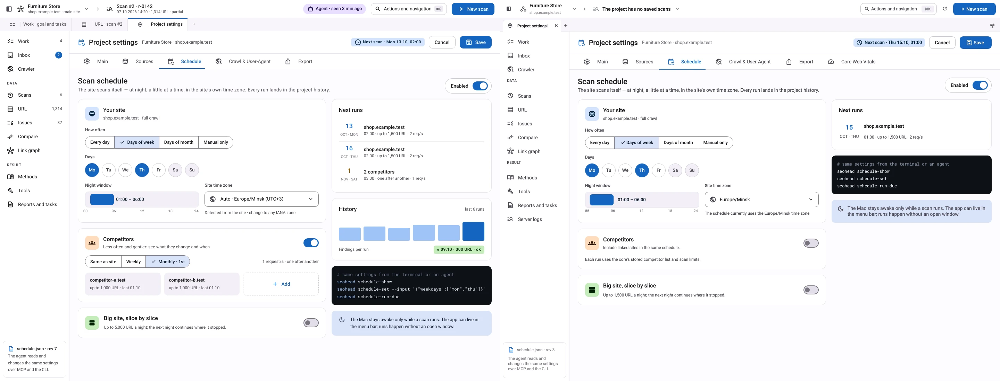
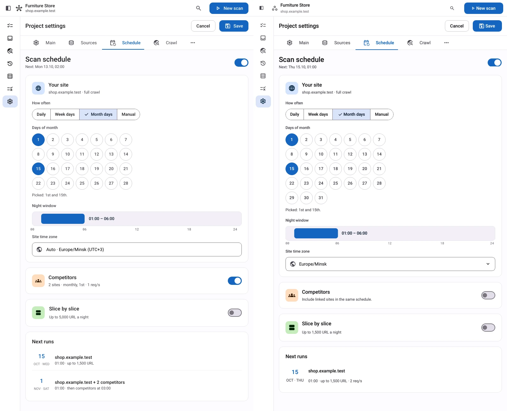
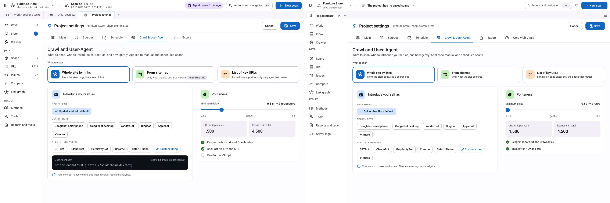
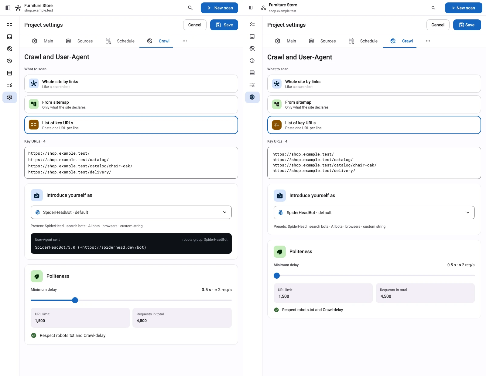

# Project settings visual review

Each comparison places the supplied reference on the left and the application on the right. The application reads persisted synthetic project settings through the normal core interface; the captures do not edit them.

| Screen | Width | Saved state |
| --- | --- | --- |
| Schedule | 1440 | Monday and Thursday |
| Schedule | 800 | First and fifteenth days of the month |
| Crawl | 1440 | Whole-site mode |
| Crawl | 800 | Four explicit URLs |

The current contract supplies one next run. These fixtures have no previous scheduled runs or linked competitors. The interface hides unavailable history and the unresolved preset header. Calendar choices include all 31 days, and the scheduled delay range remains 0.5–60 seconds. The integrated provider work adds Core Web Vitals, with compact settings reached through the overflow menu.

